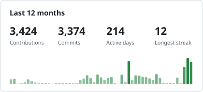
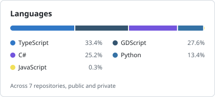

### Hi, I'm Petr

Full-stack developer working mostly in TypeScript. In my own time I build civic tools for Armenia and small games under the name **Tiny Forge**.

#### Projects

| | |
| --- | --- |
| **[open-roads-am](https://github.com/nightlightmare/open-roads-am)** | Report road problems in Armenia: a public map, AI photo classification, moderation and an open API. Next.js, Fastify, PostGIS, MCP. [Live](https://open-roads-am-web.vercel.app) |
| **[Pixel Castle](https://tinyforgegs.itch.io/pixel-castle)** | A compact real-time strategy game on a hex map: 6 campaigns, 30 missions, plays in the browser and on a phone. Godot. |
| **[Tiny Terminal](https://tinyforgegs.itch.io/tiny-terminal)** | A low-poly airport tycoon for PC, in development. Godot .NET. |

#### Stack

TypeScript · React / Next.js · Node.js / Fastify · PostgreSQL / PostGIS · Python · Godot (GDScript, C#) · Docker

#### Activity

<picture>
  <source media="(prefers-color-scheme: dark)" srcset="assets/activity-dark.svg">
  
</picture>
<picture>
  <source media="(prefers-color-scheme: dark)" srcset="assets/languages-dark.svg">
  
</picture>

#### Elsewhere

[Telegram](https://t.me/GrishinPetr) · [Tiny Forge on itch.io](https://tinyforgegs.itch.io) · [Tiny Forge on X](https://x.com/tinyforgegs)
